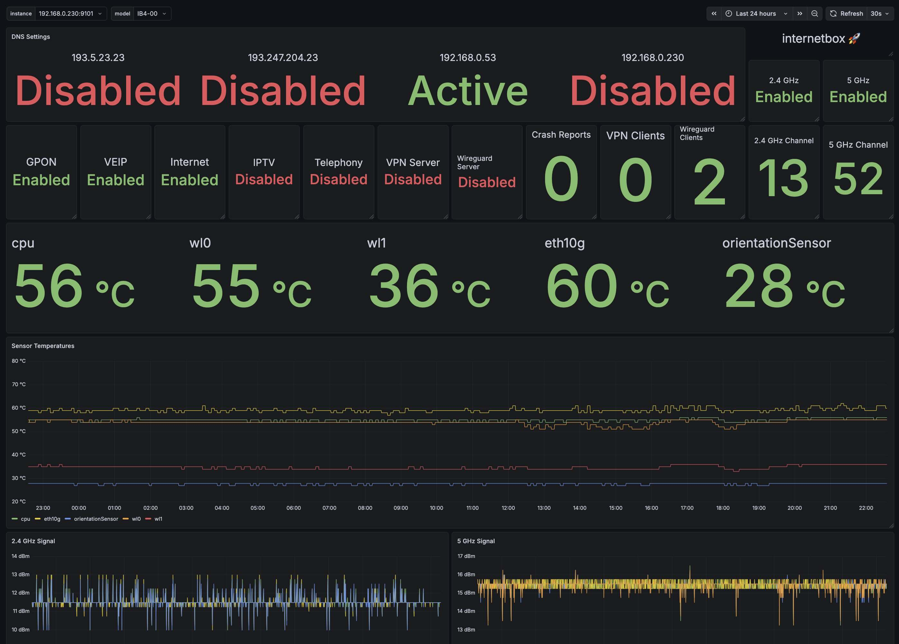

<div align="center">
  
  <h1 style="font-size: 28px; margin: 10px 0;">pyinternetbox</h1>
  <p style="font-size: 16px; margin: 0;"><b>Your Swisscom Internet Box - with batteries included.</b></p>
  <p>Python library | CLI | MCP server | Prometheus exporters | Grafana dashboards</p>
</div>
<br>

## 📚 Table of Contents

<!-- START doctoc generated TOC please keep comment here to allow auto update -->
<!-- DON'T EDIT THIS SECTION, INSTEAD RE-RUN doctoc TO UPDATE -->
<!-- DON'T EDIT THIS SECTION, INSTEAD RE-RUN doctoc TO UPDATE -->

- [🚀 Getting Started](#-getting-started)
  - [Installation](#installation)
  - [CLI usage](#cli-usage)
  - [Library usage](#library-usage)
- [📡 Running the Exporter](#-running-the-exporter)
  - [Traffic metrics: which one to use](#traffic-metrics-which-one-to-use)
  - [DNS query metrics](#dns-query-metrics)
  - [Restart metric](#restart-metric)
- [🤖 MCP Server](#-mcp-server)
  - [Setup in OpenCode](#setup-in-opencode)
  - [What the AI may do](#what-the-ai-may-do)
  - [Usage metrics](#usage-metrics)
- [Environment Variables](#environment-variables)
- [Usage without authentication](#usage-without-authentication)
- [🧑‍💻 Development](#-development)
  - [How to contribute](#how-to-contribute)
  - [Creating more complex methods](#creating-more-complex-methods)
  - [Supported Internet Box Models](#supported-internet-box-models)
  - [Model Information](#model-information)
  - [Development Requirements](#development-requirements)
  - [🪝 Pre-commit Hooks](#-pre-commit-hooks)
  - [🏷️ Releasing](#-releasing)
- [🧪 Tests](#-tests)
  - [End-to-End (E2E) Tests](#end-to-end-e2e-tests)
- [Related Projects](#related-projects)
- [Disclaimer](#disclaimer)

<!-- END doctoc generated TOC please keep comment here to allow auto update -->

## 🚀 Getting Started

### Installation

**from PyPI**:

```sh
pip install pyinternetbox          # library + `ibox` CLI
pip install "pyinternetbox[mcp]"   # also the MCP server, `ibox mcp`
uv tool install pyinternetbox      # or: just the `ibox` CLI, in its own environment
```

**with Docker** (runs the exporter):

```sh
docker run -d -p 9101:9101 -e IB_PASSWORD=secret oregonpillow/pyinternetbox:latest
```

**from source** (for development) **with uv**:

```sh
uv sync
```

**from source with pip**:

```sh
python3 -m venv .venv
source .venv/bin/activate
pip install -e .
```

### CLI usage

**with uv** (from source)

```sh
uv run ibox --help
```

**with pip / uv tool**:

```sh
ibox --help
ibox --version
```

The CLI outputs pretty JSON but can still be piped to popular tools like `jq`. `ibox devices summary` and `ibox wifi summary` give a short overview of the devices and the Wi-Fi networks.

Commands that change settings do what the matching switch or form in the web interface does. `ibox <group> --help` lists them, for example:

```sh
ibox firewall set-port-forwarding minecraft 192.168.1.20 25565 --protocol tcp
ibox devices block AA:BB:CC:DD:EE:FF
ibox mst set AA:BB:CC:DD:EE:FF --minutes-per-day 120 --allowed-time '{"Sat": 240, "Sun": 240}'
ibox wifi set-network --ssid MyHome --password 'Correct-Horse-9'
ibox wifi set-channel 2.4GHz 6 --bandwidth 20MHz
ibox firewall set-custom-rule Telnet 23 block --protocol tcp
ibox dns set-device-servers 1.1.1.1,9.9.9.9
```

`ibox wireguard add-client` prints the new VPN client's configuration, with its private key. To save it for the WireGuard app:

```sh
ibox wireguard add-client phone --endpoint myhome.ddns.net | jq -r .status > phone.conf
```

To save all settings to a file and load them back later, like the web interface's "Save Current Configuration" and "Restore Configuration" buttons (the phone book isn't included, and a restore leaves it as it is):

```sh
ibox nmc backup > internetbox.cfg
ibox nmc restore internetbox.cfg
```

`ibox nmc backup-to-swisscom` uploads the settings to Swisscom, as the web interface does when you save a change. It only works if backup to Swisscom is turned on for your router; the web interface has no setting for it. The upload runs in the background for about a minute, and `ibox nmc network-config` shows its status.

Commands that cut connections ask for confirmation first: `ibox nmc reboot`, `ibox nmc restore` (the router restarts afterwards), turning Wi-Fi or the guest Wi-Fi off, changing Wi-Fi names, passwords, channels or standards, turning on band steering or a Wi-Fi schedule, changing the DNS servers the router asks, blocking outgoing traffic in the custom firewall and turning off WireGuard or the WireGuard VPN server. So do commands that delete what can't be brought back: `ibox voice clear-call-list`, `ibox firewall delete-all-port-forwarding` and `ibox devices reset-traffic-counters`. Add `--yes` to skip the question in scripts.

### Library usage

```python
from internetbox_client import InternetBoxClient

with InternetBoxClient() as ibox:
    print(ibox.nmc.status())         # no auth required
    print(ibox.wifi.status())        # no auth required
    print(ibox.devices.topology())   # auth required
    print(ibox.vpn.status())         # auth required
```

For tools built on the library, e.g. the [MCP server](#-mcp-server), each method is labelled with what it does to the router, and `hide_secrets()` replaces passwords and keys in a response. The library and the CLI show them.

```python
import json

from internetbox_client.utils.helpers import hide_secrets
from internetbox_client.utils.labels import action

action(ibox.wifi.summary)                      # "read"; also "write" or "disruptive" (cuts connections)
hide_secrets(json.loads(ibox.wifi.summary()))  # passwords and keys become "<hidden>"
```

## 📡 Running the Exporter

The exporter exposes router metrics in [Prometheus](https://prometheus.io/) format on port `9101`.
Only a sample of metrics are currently implemented - contributions are welcome!

**with uv / pip**:

```sh
ibox export
```

**with Docker Compose**:

Set environment variables in `docker-compose.yml`, then:

```sh
docker compose up -d
```

Images are published to Docker Hub as [`oregonpillow/pyinternetbox`](https://hub.docker.com/r/oregonpillow/pyinternetbox):

| **Tag**        | **Contents**                                     |
| -------------- | ------------------------------------------------ |
| `latest`       | Most recent release                              |
| `X.Y.Z`, `X.Y` | A specific release / the latest patch of a minor |
| `edge`         | Latest commit on `master` (may be unstable)      |

Metrics will be available at `http://localhost:9101/metrics`.

example Prometheus config:

```yaml
scrape_configs:
  - job_name: "pyinternetbox"
    scrape_interval: 30s
    metrics_path: /metrics
    static_configs:
      - targets: ["localhost:9101"]
```

### Traffic metrics: which one to use

The router exposes several traffic figures that look similar but measure different things. `rx`/`tx` are always from the
**router's point of view**: `rx` is what the router _received_ on that interface, `tx` is what it _sent_.

| Metric                                                                                    | Interface                       | What it counts                                                                                                  | `rx` means                               | `tx` means                                 | Type                                  | Includes wired devices  | Includes traffic between home devices |
| ----------------------------------------------------------------------------------------- | ------------------------------- | --------------------------------------------------------------------------------------------------------------- | ---------------------------------------- | ------------------------------------------ | ------------------------------------- | ----------------------- | ------------------------------------- |
| `internetbox_wan_rx_bytes_total` / `internetbox_wan_tx_bytes_total`                       | `veip0` (XGS-PON fibre, WAN)    | All traffic between your home and the internet, from every device                                               | **Downloaded** from the internet         | **Uploaded** to the internet               | Counter (bytes since router boot)     | ✅                      | ❌                                    |
| `internetbox_wifi_rx_bytes_total` / `internetbox_wifi_tx_bytes_total`                     | `wl0` (5 GHz), `wl1` (2.4 GHz)  | All traffic over each Wi-Fi radio, to the internet _and_ to other devices at home                               | Sent **by Wi-Fi devices** (their upload) | Sent **to Wi-Fi devices** (their download) | Counter (bytes since router boot)     | ❌                      | ✅ (Wi-Fi devices only)               |
| `internetbox_device_rx_bandwidth_last{day,week,month}_bytes` / `…_tx_…`                   | Per device (router device list) | The router's own per-device usage over a **rolling** window (last 24 h / 7 d / 30 d), recalculated about hourly | Received from the device                 | Sent to the device                         | Gauge (rolling total, goes up & down) | ❌ (Wi-Fi devices only) | ❓ not verified                       |
| `internetbox_veip_downstream_curr_rate_kbps` / `internetbox_veip_upstream_curr_rate_kbps` | `veip0` (XGS-PON fibre, WAN)    | The **link speed** the fibre connection is synced at (capacity), not traffic. Constant unless the link resyncs  | –                                        | –                                          | Gauge (kbps)                          | –                       | –                                     |

Notes:

- **"How much did I download today?"** → `increase(internetbox_wan_rx_bytes_total[<seconds since midnight>s])`.
- **"How fast am I downloading right now?"** → `rate(internetbox_wan_rx_bytes_total[5m]) * 8` (bits per second). The
  `veip_*_curr_rate_kbps` metrics stay at the line speed (e.g. ~10 Gbit/s) no matter how much you download.
- **Wired traffic between home devices is not measured anywhere**: it is switched by the router's Ethernet switch and
  never counted, and per-port Ethernet counters (`eth0`-`eth4`) are not accessible with the `admin` user (HTTP 401).
- The router's `bridge` interface is **not** exported: it only sees traffic routed through the router (i.e. internet
  traffic, counted again from the LAN side with `rx`/`tx` swapped), so it duplicates the WAN counters.
- Counters restart from zero when the Internet Box reboots; Prometheus' `rate()` and `increase()` handle this.
- The per-device rolling totals are only reported for Wi-Fi devices. The direction of their `rx`/`tx` follows the
  router's naming and has not been independently verified.

### DNS query metrics

The router answers the DNS queries of devices that use it as their DNS server (the default). It answers some itself and
passes the rest on to its DNS servers (your provider's, or those set with `ibox dns set-upstream-servers`). All of these
are counters that count since the router last booted.

| Metric                                    | Labels   | What it counts                                                        |
| ----------------------------------------- | -------- | --------------------------------------------------------------------- |
| `internetbox_dns_local_answered_total`    |          | Queries the router answered itself, from its cache or its own records |
| `internetbox_dns_queries_forwarded_total` |          | Queries the router passed on to a DNS server                          |
| `internetbox_dns_cache_inserted_total`    |          | Answers added to the router's DNS cache                               |
| `internetbox_dns_cache_live_freed_total`  |          | Answers dropped from the cache before they expired, to make room      |
| `internetbox_dns_queries_sent_total`      | `server` | Queries sent to that DNS server                                       |
| `internetbox_dns_queries_failed_total`    | `server` | Queries to that DNS server that failed                                |
| `internetbox_dns_queries_retried_total`   | `server` | Queries to that DNS server that were retried                          |

- **"Is my DNS server failing?"** → `increase(internetbox_dns_queries_failed_total[1h]) > 0`.
- The two cache counters stay at 0 while the router's DNS cache is off (see `ibox dns cache`).
- The router also reports `dns_auth_answered`, `fallback` and `dns_queries_failed_or_retried`. They aren't exported: the
  first two are unclear (always 0 so far), and the last is just failed + retried.

### Restart metric

`internetbox_boots_total` counts how often the router has started: after a restart, a firmware upgrade or a power cut.

- **"Did the router restart in the last day?"** → `increase(internetbox_boots_total[1d]) > 0`.
- `ibox nmc reboot-history` shows when and why it started the last 10 times.

Dashboards can be found in the Grafana folder.

<p align="center">
  
</p>

## 🤖 MCP Server

`ibox mcp` is an [MCP](https://modelcontextprotocol.io/) server: it lets an AI app such as [OpenCode](https://opencode.ai/) or Claude Desktop look at your router, e.g. "which devices are on the Wi-Fi?" or "why is my internet slow?", and change settings if you allow it. The app starts the server itself and talks to it over stdio, on your computer.

It needs the optional `mcp` dependencies: `pip install "pyinternetbox[mcp]"`, or no install at all with `uvx --from "pyinternetbox[mcp]" ibox mcp`.

<p align="center">
  
</p>

### Setup in OpenCode

Add the server to `opencode.json` in a project, or to `~/.config/opencode/opencode.json` for every project:

```json
{
  "$schema": "https://opencode.ai/config.json",
  "mcp": {
    "servers": {
      "ibox": {
        "type": "local",
        "command": ["uvx", "--from", "pyinternetbox[mcp]", "ibox", "mcp"],
        "environment": {
          "IB_PASSWORD": "{env:IB_PASSWORD}"
        }
      }
    }
  }
}
```

`{env:IB_PASSWORD}` takes the router password from the environment OpenCode runs in. Options for the router, e.g. `-H`, go before `mcp`, and the server's options after it: `["uvx", "--from", "pyinternetbox[mcp]", "ibox", "-H", "192.168.1.1", "mcp", "--allow-writes"]`. `opencode mcp list` checks that the server starts. Other apps that start local MCP servers work the same way: they run `ibox mcp` with `IB_PASSWORD` set.

### What the AI may do

| **Option**           | **Effect**                                                                                                                                                                                                                                          |
| -------------------- | --------------------------------------------------------------------------------------------------------------------------------------------------------------------------------------------------------------------------------------------------- |
| _(none)_             | Read only: overviews of the router, devices, Wi-Fi, internet connection, firewall, DNS, home network, parental controls and remote access, and every other read function of the library through `list_router_functions` and `call_router_function`. |
| `--allow-writes`     | Also changes: rename, block, schedule, wake or forget devices, port forwards, fixed IP addresses, DNS servers for devices, the speed test, and the library's other settings through `change_router_setting`.                                        |
| `--allow-disruptive` | Also changes that cut the Wi-Fi or internet for others: Wi-Fi and guest Wi-Fi on or off, Wi-Fi names, passwords and channels, and restarting the router. Implies `--allow-writes`.                                                                  |
| `--show-secrets`     | Shows passwords and keys, e.g. the Wi-Fi password or a new WireGuard client's private key. Without it they show as `<hidden>`. Confirmation questions always hide them.                                                                             |
| `--metrics-url URL`  | Sends usage metrics to `ibox mcp-exporter` (see below).                                                                                                                                                                                             |

Changes that cut connections ask you first, in the app, like the CLI does: e.g. turning Wi-Fi off, changing Wi-Fi names, passwords or channels, or restarting the router. If you say no, nothing changes. In apps that can't ask (MCP elicitation), these changes are refused: make them with the CLI or the web interface. Other changes don't ask: allow them only if you're happy for the AI to make them, or use your app's permission settings for tools.

The server never offers restoring a backup, factory reset, firmware upgrades, password or LAN address changes, or telephony (calls, DECT, phone book).

`run_speed_test` runs the router's speed test and waits for the ping, download and upload speed: about a minute, during which it uses the whole connection, so everyone's internet is slower. The router doesn't keep the result, so `speed_test_results` shows a test running now and the last result of this server.

Answers are compact JSON, cut off after 25,000 characters so they don't fill the model's context.

### Usage metrics

AI apps start an `ibox mcp` process per window or project, which Prometheus can't scrape. Instead, each one sends an event per tool call to a collector, `ibox mcp-exporter`, which Prometheus scrapes:

```sh
ibox mcp-exporter    # listens on 127.0.0.1:9102; needs no router access
```

Then add `"--metrics-url", "http://127.0.0.1:9102"` after `mcp` in the app's command, or `"IB_MCP_METRICS_URL": "http://127.0.0.1:9102"` to its `environment`. Events carry the tool, the library function it called, its outcome and duration, and the app's name, never the arguments or the answer. When the collector isn't running, events are dropped with one warning, and tool calls never wait for it.

```yaml
scrape_configs:
  - job_name: "ibox-mcp"
    static_configs:
      - targets: ["localhost:9102"]
```

If Prometheus runs in Docker, start the collector with `--host 0.0.0.0`. It then accepts events from anyone who can reach the port.

| **Metric**                            | **Type**  | **Labels**                                                                                                                                                                                                                                                                          |
| ------------------------------------- | --------- | ----------------------------------------------------------------------------------------------------------------------------------------------------------------------------------------------------------------------------------------------------------------------------------- |
| `ibox_mcp_tool_calls_total`           | Counter   | `tool`, e.g. `list_devices`; `function`, the library function it called, e.g. `wifi.summary`; `action`: `read`, `write` or `disruptive`; `outcome`: `ok`, `error`, `refused` (not allowed, or the app can't ask) or `declined` (you said no); `client`, the AI app, e.g. `opencode` |
| `ibox_mcp_tool_call_duration_seconds` | Histogram | `tool`                                                                                                                                                                                                                                                                              |
| `ibox_mcp_events_received_total`      | Counter   |                                                                                                                                                                                                                                                                                     |
| `ibox_mcp_events_rejected_total`      | Counter   | `reason`, e.g. `invalid tool`                                                                                                                                                                                                                                                       |

For example, the tool calls of the last day: `sum by (tool) (increase(ibox_mcp_tool_calls_total[1d]))`.

## Environment Variables

| **Variable**           | **Description**                                                                                                                                                                                                                                               | **Required** |
| ---------------------- | ------------------------------------------------------------------------------------------------------------------------------------------------------------------------------------------------------------------------------------------------------------- | ------------ |
| `IB_HOSTNAME`          | Hostname or IP address of the Internet Box router, e.g. `192.168.1.1` or `https://192.168.1.1`. `http://` is upgraded to `https://`. Defaults to `https://internetbox.swisscom.ch`.                                                                           | No           |
| `IB_USERNAME`          | Username for router authentication. Defaults to `admin`.                                                                                                                                                                                                      | No           |
| `IB_PASSWORD`          | Password for router authentication. Defaults to an empty string. Without a password many of the client methods will not work. See below for complete list of methods that don't require authentication.                                                       | No           |
| `IB_EXPORTER_PORT`     | TCP port the Prometheus `/metrics` endpoint listens on. Defaults to `9101`.                                                                                                                                                                                   | No           |
| `IB_EXPORTER_INTERVAL` | Seconds between data collection cycles when running the exporter. Defaults to `30`.                                                                                                                                                                           | No           |
| `IB_SSL_VERIFY`        | `true` / `false` to force SSL certificate verification on or off (CLI: `--insecure` / `-k`). When unset, verification is on for hostnames and automatically off for IP addresses, since the router's certificate is only valid for `internetbox.swisscom.ch`. | No           |
| `IB_MCP_METRICS_URL`   | Where `ibox mcp` sends usage metrics, e.g. `http://127.0.0.1:9102` (CLI: `--metrics-url`). Unset: none are sent.                                                                                                                                              | No           |
| `IB_MCP_EXPORTER_HOST` | Address `ibox mcp-exporter` listens on. Defaults to `127.0.0.1`.                                                                                                                                                                                              | No           |
| `IB_MCP_EXPORTER_PORT` | TCP port `ibox mcp-exporter` listens on. Defaults to `9102`.                                                                                                                                                                                                  | No           |

## Usage without authentication

A limited selection of methods are available without authentication, which means they can be used even if you don't have the password to your router.

| **Method**              | **API**                           | **CLI**                         |
| ----------------------- | --------------------------------- | ------------------------------- |
| Devices.info            | `ibox.devices.info()`             | `ibox devices info`             |
| DNS.status              | `ibox.dns.status()`               | `ibox dns status`               |
| Mitigation.status       | `ibox.mitigation.status()`        | `ibox mitigation status`        |
| NMC.status              | `ibox.nmc.status()`               | `ibox nmc status`               |
| NMC.ip_conflicts        | `ibox.nmc.ip_conflicts()`         | `ibox nmc ip-conflicts`         |
| NMC.wan_status          | `ibox.nmc.wan_status()`           | `ibox nmc wan-status`           |
| NMC.orientation         | `ibox.nmc.orientation()`          | `ibox nmc orientation`          |
| PasswordRecovery.status | `ibox.password_recovery.status()` | `ibox password-recovery status` |
| Static.settings         | `ibox.static.settings()`          | `ibox static settings`          |
| Static.translations     | `ibox.static.translations()`      | `ibox static translations`      |
| Sysbus.gpios            | `ibox.sysbus.gpios()`             | `ibox sysbus gpios`             |
| Sysbus.mibs             | `ibox.sysbus.mibs()`              | `ibox sysbus mibs`              |
| Sysbus.veip             | `ibox.sysbus.veip()`              | `ibox sysbus veip`              |
| Sysbus.veip_mibs        | `ibox.sysbus.veip_mibs()`         | `ibox sysbus veip-mibs`         |
| Sysbus.net_dev_stats    | `ibox.sysbus.net_dev_stats()`     | `ibox sysbus net-dev-stats`     |
| Voice.status            | `ibox.voice.status()`             | `ibox voice status`             |
| Voice.trunks            | `ibox.voice.trunks()`             | `ibox voice trunks`             |
| Wifi.status             | `ibox.wifi.status()`              | `ibox wifi status`              |
| WWAN.status             | `ibox.wwan.status()`              | `ibox wwan status`              |
| WWAN.mibs               | `ibox.wwan.mibs()`                | `ibox wwan mibs`                |

\*Methods that do not require authentication have the following parameter set within their respective method: `auth_required=False`. Search for this in codebase if you need to identify them.

## 🧑‍💻 Development

So far the project is in early stages and I'm the only contributor, but I welcome contributions from the community! If you want to contribute, please fork the repository and create a pull request with your changes. At the moment I've only tested with an IB4 box, if you have a different box any testing you can provide would be greatly appreciaited! :)

### How to contribute

- Read the [MISSING_ENDPOINTS](https://github.com/oregonpillow/pyinternetbox/blob/master/docs/MISSING_ENDPOINTS.md) doc if you want to work on implementing missing endpoints: what could still be added, and what's left out or not possible, and why
- Check the [API_MAP](https://github.com/oregonpillow/pyinternetbox/blob/master/docs/API_MAP.md) for every endpoint the web interface calls and every function the router exposes, and which ones are implemented. Re-generate it for your model or firmware with `uv run scripts/discover_endpoints.py -H 192.168.1.1 -k`
- Try creating more complex methods, see below for more details
- Take a stab at implementing any bugs or features raised in the issues
- Test the library with different Swisscom/Wingo Internet Box models and report any issues you find - testers are much appreciaited!!
- Contribute more dashboards :)
- Add missing metrics in the exporter: only a subset of methods in this client are currently implemented
- Improve the pipeline
- Buy me a coffee ☕️ ;)

### Creating more complex methods

When logged into the web interface, within developer tools you can see the REST-API logic within the js scripts.

Pretty much all the REST-API logic is contained within these. These scripts could be parsed to find missing endpoints and provide a template for how to interact and combine calls for more powerful dynamic methods. `scripts/discover_endpoints.py` does the first part: it lists the endpoints and parameter names the scripts use in [API_MAP](https://github.com/oregonpillow/pyinternetbox/blob/master/docs/API_MAP.md).

The scripts likely differ based on the Web portal version.
The `Web portal version` can be found in the web gui: `Diagnostics > Internet-Box`.

To view the js scripts:

> 1. Open your Internet Box web interface (e.g. `https://internetbox.swisscom.ch`) and log in
> 2. Open your browser's Developer Tools (F12) → **Network** tab
> 3. Reload the page and filter by JS — download `app.min.js` and `core.min.js`

### Supported Internet Box Models

| **Model**          | **Tested** | **Notes**                     |
| ------------------ | ---------- | ----------------------------- |
| Internet Box 2     | No         | Expected to work partially    |
| Internet Box 3     | No         | Expected to work partially    |
| Internet Box 4     | ✅         | Tested and confirmed to work. |
| Internet Box 5     | No         | Expected to work              |
| Internet Box 5 Pro | No         | Expected to work              |

### Model Information

| **Model**      | **Manufacturer** | **Model Name** | **OUI Number** |
| -------------- | ---------------- | -------------- | -------------- |
| Internet Box 4 | Arcadyan         | IB4-00         | 1883BF         |

To check your model run `ibox devices info`. Submit a PR if you have a model not listed here.

### Development Requirements

In order to run tests and pre-commit hooks you need to have the development dependencies installed.

In addition to UV, you will need [prettier](https://prettier.io/) and [doctoc](https://github.com/thlorenz/doctoc) to run pre-commit hooks. You can install npx with [npm](https://nodejs.org/en/download/) and then use npx to install the tools:

```sh
npm install -g npx
npx install -g doctoc
npx install -g prettier
```

Clone the repo and install all dependencies including dev tools:

```sh
uv sync
```

### 🪝 Pre-commit Hooks

This project uses pre-commit hooks. To set it up:

- `uv tool install pre-commit --with pre-commit-uv`
- `uvx pre-commit install`
- test by running all hooks: `uvx pre-commit run -a`

### 🏷️ Releasing

The version is defined **only by the git tag** — there is no version number to edit in any file.
[hatch-vcs](https://github.com/ofek/hatch-vcs) derives it at build time, and it flows into the PyPI package, `ibox --version`, the Docker image tags and the exporter's startup line.

First write the release notes: a section for the new version at the top of [`CHANGELOG.md`](https://github.com/oregonpillow/pyinternetbox/blob/master/CHANGELOG.md). Note changes under `## [Unreleased]` as you make them, if you like. In [OpenCode](https://opencode.ai/), `/release-notes v0.2.0` turns that section into the version's: it checks it against the changes since the last release, completes it (or writes it from the changes, if nothing was noted), and starts a new, empty `[Unreleased]`. Read and correct the draft, then commit it. `uv run scripts/release_notes.py v0.2.0` shows the notes as the release will have them.

Then tag the commit that has the notes:

```sh
git checkout master && git pull
git tag v0.2.0
git push origin v0.2.0
```

Pushing the tag runs [`release.yml`](https://github.com/oregonpillow/pyinternetbox/blob/master/.github/workflows/release.yml), which runs the tests and then:

- publishes `pyinternetbox==0.2.0` to PyPI
- pushes `oregonpillow/pyinternetbox:0.2.0`, `:0.2` and `:latest` to Docker Hub
- creates a GitHub Release with the version's section of `CHANGELOG.md` as its notes, and the built packages

The release stops before anything is published if `CHANGELOG.md` has no section for the version.

Every push to `master` also publishes `oregonpillow/pyinternetbox:edge`. Untagged builds get a development version such as `0.2.1.dev3+g1a2b3c4`.

**Choosing the version** ([semver](https://semver.org/)): bump `PATCH` for bug fixes, `MINOR` for new endpoints/metrics/options, `MAJOR` for breaking changes. Use plain `vMAJOR.MINOR.PATCH` tags (no `-rc1` style suffixes). To see the version the current commit would get: `uv run ibox --version`.

**If a release fails** before anything is published (e.g. tests fail), fix the problem on `master`, then move the tag:

```sh
git tag -d v0.2.0 && git push origin :refs/tags/v0.2.0
git tag v0.2.0 && git push origin v0.2.0
```

PyPI never accepts the same version twice, so if the package was already uploaded, release a new patch version (`v0.2.1`) instead.

**One-time setup** (already done for this repo, kept here for reference):

- GitHub → Settings → Secrets and variables → Actions: `DOCKERHUB_USERNAME` and `DOCKERHUB_TOKEN` (a Docker Hub personal access token with _Read & Write_ access).
- pypi.org → Account → Publishing: trusted publisher for owner `oregonpillow`, repository `pyinternetbox`, workflow `release.yml`, environment `pypi`.

## 🧪 Tests

| **Test**       | **Description**                                                                                                                                                                                                                                                                                        | **Check**                            | **Fix**                         |
| -------------- | ------------------------------------------------------------------------------------------------------------------------------------------------------------------------------------------------------------------------------------------------------------------------------------------------------ | ------------------------------------ | ------------------------------- |
| **Unit Tests** | Run unit tests                                                                                                                                                                                                                                                                                         | `uv run pytest`                      | N/A                             |
| **End-to-End** | Makes real HTTP requests to your router and verifies every endpoint returns a valid HTTP response code. Excluded from the default test run. Requires `IB_PASSWORD` to be set (see [Environment Variables](#environment-variables)). Read-only and destructive tests can be run separately (see below). | `uv run pytest tests/test_e2e.py -v` | N/A                             |
| **Coverage**   | Check test coverage                                                                                                                                                                                                                                                                                    | `uv run pytest --cov`                | N/A                             |
| **Linting**    | Check code for linting issues                                                                                                                                                                                                                                                                          | `uv run ruff check .`                | `uv run ruff check --fix .`     |
| **Formatting** | Check code formatting                                                                                                                                                                                                                                                                                  | `uv run ruff format --check .`       | `uv run ruff format .`          |
| **isort**      | Check import sorting consistency                                                                                                                                                                                                                                                                       | `ruff check --select I .`            | `ruff check --select I --fix .` |
| **deptry**     | Checks unused or missing dependencies                                                                                                                                                                                                                                                                  | `uv run deptry .`                    | N/A                             |
| **prettier**   | Check markdown formatting                                                                                                                                                                                                                                                                              | `npx prettier --check .`             | `npx prettier --write .`        |
| **doctoc**     | Auto-generate table of contents in markdown                                                                                                                                                                                                                                                            | `npx doctoc README.md`               | `npx doctoc README.md`          |

### End-to-End (E2E) Tests

⚠️ Use the E2E tests with caution especially if you have a production router (any router where downtime could expose you to the wrath of your partner or roommates).

The tests are designed to be safe but they do make real HTTP requests to your router and some of the tests are destructive (they change a setting on the router and then attempt to change it back). If you want to be extra cautious you can run only the read-only tests which shouldn't make any changes to the router.

```sh
# 🔬 Read-only — should be safe for any environment
uv run pytest tests/test_e2e.py -m "not destructive" -v

# 💥 All tests including destructive (writes to the router, then reverts)
uv run pytest tests/test_e2e.py -v

# 💥 Only destructive tests
uv run pytest tests/test_e2e.py -m destructive -v

# 📴 Also tests that briefly cut the network for everyone (guest Wi-Fi on/off, all Wi-Fi off/on, Wi-Fi channels and standards, band steering, the router's DNS servers, Wi-Fi schedule, VPN server on/off, WireGuard off/on)
IB_E2E_DISRUPTIVE=1 uv run pytest tests/test_e2e.py -m disruptive -v
```

Destructive tests leave the router as they found it. They write the current value back (LED brightness, Wi-Fi TX power, firewall levels, the custom firewall's basic actions, ping replies, the DNS cache switch, WLAN-Box sync, 6 GHz power saving, the DynDNS and WireGuard switches), or create something temporary and delete it again: a disabled port forwarding rule, protocol forwarding rule, IPv6 pinhole and custom firewall rule and a DynDNS host that the router doesn't keep up to date, named after `pyinternetbox-e2e`, a WireGuard client named `pyiboxe2e`, a static route to the unused network `172.31.254.0/24`, and a device entry with a type and DNS name, IP address reservations on the home and guest networks, an access schedule and its overrides, time limit and band steering exception for the made-up MAC address `02:00:00:00:00:01`. They skip instead of touching existing settings, e.g. when a DMZ host, another DynDNS host or a Wi-Fi schedule is set, or the guest Wi-Fi is on. Saving the log files replaces the ones saved on the router before.

Tests that cut the network for everyone are skipped unless `IB_E2E_DISRUPTIVE=1` is set. The tests that turn Wi-Fi off and on or write the Wi-Fi names, channels or standards back also skip unless the machine running them is connected to the router by cable, since it could lose its connection otherwise. Turning Wi-Fi off and on leaves the guest network off, so the test turns it back on if it was on.

## Related Projects

- [LiveboxMonitor](https://github.com/p-dor/LiveboxMonitor)
- [sysbus](https://github.com/rene-d/sysbus)
- [internetbox2-exporter](https://github.com/simonkrenger/internetbox2-exporter)

## Disclaimer

While I work at Swisscom, this project is a personal endeavor and is not affiliated with or endorsed by Swisscom. The information provided in this project is based on my own research and experience from observing the REST-API calls the router makes when you login using developer tools in your browser. Use at your own risk. I don't work with the Internet Box team or have any affiliation with them.
