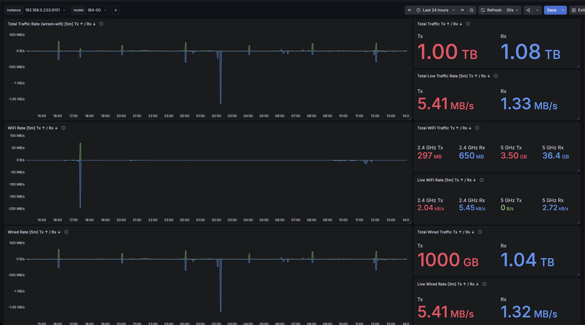

# Exporter

The exporter exposes router metrics in [Prometheus](https://prometheus.io/) format on port `9101`.
Only a sample of metrics are currently implemented - contributions are welcome!

It needs the router password (`IB_PASSWORD`, see [Environment variables](reference/environment-variables.md)), and stops straight away if it's missing or the router refuses it. If the router can't be reached, e.g. while it restarts, the exporter keeps trying.

## Running it

**with uv / pip**:

```sh
ibox export
```

**with Docker Compose**:

Set environment variables in [`docker-compose.yml`](https://github.com/oregonpillow/pyinternetbox/blob/master/docker-compose.yml), then:

```sh
docker compose up -d
```

Images are published to Docker Hub as [`oregonpillow/pyinternetbox`](https://hub.docker.com/r/oregonpillow/pyinternetbox):

| **Tag**        | **Contents**                                     |
| -------------- | ------------------------------------------------ |
| `latest`       | Most recent release                              |
| `X.Y.Z`, `X.Y` | A specific release / the latest patch of a minor |
| `edge`         | Latest commit on `master` (may be unstable)      |

Metrics will be available at `http://localhost:9101/metrics`.

example Prometheus config:

```yaml
scrape_configs:
  - job_name: "pyinternetbox"
    scrape_interval: 30s
    metrics_path: /metrics
    static_configs:
      - targets: ["localhost:9101"]
```

## Traffic metrics: which one to use

The router exposes several traffic figures that look similar but measure different things. `rx`/`tx` are always from the
**router's point of view**: `rx` is what the router _received_ on that interface, `tx` is what it _sent_.

| Metric                                                                                    | Interface                       | What it counts                                                                                                  | `rx` means                               | `tx` means                                 | Type                                  | Includes wired devices  | Includes traffic between home devices |
| ----------------------------------------------------------------------------------------- | ------------------------------- | --------------------------------------------------------------------------------------------------------------- | ---------------------------------------- | ------------------------------------------ | ------------------------------------- | ----------------------- | ------------------------------------- |
| `internetbox_wan_rx_bytes_total` / `internetbox_wan_tx_bytes_total`                       | `veip0` (XGS-PON fibre, WAN)    | All traffic between your home and the internet, from every device                                               | **Downloaded** from the internet         | **Uploaded** to the internet               | Counter (bytes since router boot)     | ✅                      | ❌                                    |
| `internetbox_wifi_rx_bytes_total` / `internetbox_wifi_tx_bytes_total`                     | `wl0` (5 GHz), `wl1` (2.4 GHz)  | All traffic over each Wi-Fi radio, to the internet _and_ to other devices at home                               | Sent **by Wi-Fi devices** (their upload) | Sent **to Wi-Fi devices** (their download) | Counter (bytes since router boot)     | ❌                      | ✅ (Wi-Fi devices only)               |
| `internetbox_device_rx_bandwidth_last{day,week,month}_bytes` / `…_tx_…`                   | Per device (router device list) | The router's own per-device usage over a **rolling** window (last 24 h / 7 d / 30 d), recalculated about hourly | Received from the device                 | Sent to the device                         | Gauge (rolling total, goes up & down) | ❌ (Wi-Fi devices only) | ❓ not verified                       |
| `internetbox_veip_downstream_curr_rate_kbps` / `internetbox_veip_upstream_curr_rate_kbps` | `veip0` (XGS-PON fibre, WAN)    | The **link speed** the fibre connection is synced at (capacity), not traffic. Constant unless the link resyncs  | –                                        | –                                          | Gauge (kbps)                          | –                       | –                                     |

Notes:

- **"How much did I download today?"** → `increase(internetbox_wan_rx_bytes_total[<seconds since midnight>s])`.
- **"How fast am I downloading right now?"** → `rate(internetbox_wan_rx_bytes_total[5m]) * 8` (bits per second). The
  `veip_*_curr_rate_kbps` metrics stay at the line speed (e.g. ~10 Gbit/s) no matter how much you download.
- **Wired traffic between home devices is not measured anywhere**: it is switched by the router's Ethernet switch and
  never counted, and per-port Ethernet counters (`eth0`-`eth4`) are not accessible with the `admin` user (HTTP 401).
- The router's `bridge` interface is **not** exported: it only sees traffic routed through the router (i.e. internet
  traffic, counted again from the LAN side with `rx`/`tx` swapped), so it duplicates the WAN counters.
- Counters restart from zero when the Internet Box reboots; Prometheus' `rate()` and `increase()` handle this.
- The per-device rolling totals are only reported for Wi-Fi devices. The direction of their `rx`/`tx` follows the
  router's naming and has not been independently verified.

## DNS query metrics

The router answers the DNS queries of devices that use it as their DNS server (the default). It answers some itself and
passes the rest on to its DNS servers (your provider's, or those set with `ibox dns set-upstream-servers`). All of these
are counters that count since the router last booted.

| Metric                                    | Labels   | What it counts                                                        |
| ----------------------------------------- | -------- | --------------------------------------------------------------------- |
| `internetbox_dns_local_answered_total`    |          | Queries the router answered itself, from its cache or its own records |
| `internetbox_dns_queries_forwarded_total` |          | Queries the router passed on to a DNS server                          |
| `internetbox_dns_cache_inserted_total`    |          | Answers added to the router's DNS cache                               |
| `internetbox_dns_cache_live_freed_total`  |          | Answers dropped from the cache before they expired, to make room      |
| `internetbox_dns_queries_sent_total`      | `server` | Queries sent to that DNS server                                       |
| `internetbox_dns_queries_failed_total`    | `server` | Queries to that DNS server that failed                                |
| `internetbox_dns_queries_retried_total`   | `server` | Queries to that DNS server that were retried                          |

- **"Is my DNS server failing?"** → `increase(internetbox_dns_queries_failed_total[1h]) > 0`.
- The two cache counters stay at 0 while the router's DNS cache is off (see `ibox dns cache`).
- The router also reports `dns_auth_answered`, `fallback` and `dns_queries_failed_or_retried`. They aren't exported: the
  first two are unclear (always 0 so far), and the last is just failed + retried.

## Restart metric

`internetbox_boots_total` counts how often the router has started: after a restart, a firmware upgrade or a power cut.

- **"Did the router restart in the last day?"** → `increase(internetbox_boots_total[1d]) > 0`.
- `ibox nmc reboot-history` shows when and why it started the last 10 times.

## Grafana dashboards

Dashboards can be found in the [Grafana folder](https://github.com/oregonpillow/pyinternetbox/tree/master/grafana).


