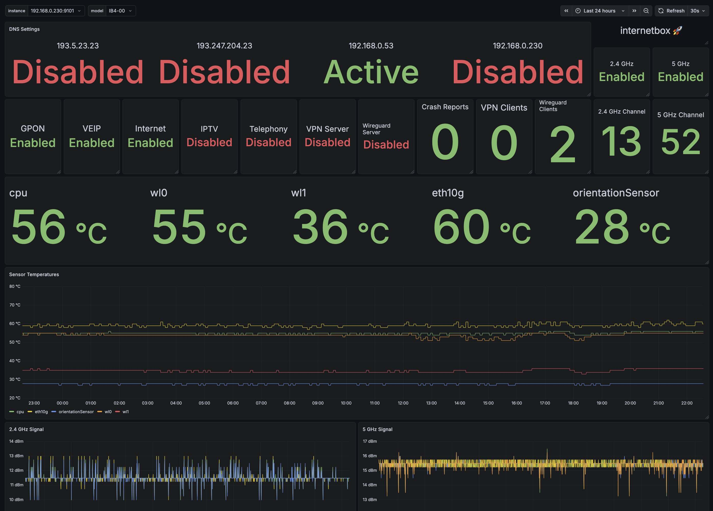

# pyinternetbox

**Your Swisscom Internet Box - with batteries included.**



pyinternetbox talks to the Swisscom Internet Box the way its web interface does. It comes as:

- a **Python library**: see [Getting started](getting-started.md#library-usage) and the [library reference](reference/library/index.md)
- the **`ibox` CLI**, with every library function as a command: see [Getting started](getting-started.md#cli-usage)
- a **Prometheus exporter** with **Grafana dashboards**: see [Exporter](exporter.md)
- an **MCP server**, for AI apps such as OpenCode or Claude Desktop: see [MCP server](mcp.md)

```sh
pip install pyinternetbox          # library + `ibox` CLI
pip install "pyinternetbox[mcp]"   # also the MCP server, `ibox mcp`
```

It's tested on the Internet Box 4: see [Supported models](reference/models.md).

## Related projects

- [LiveboxMonitor](https://github.com/p-dor/LiveboxMonitor)
- [sysbus](https://github.com/rene-d/sysbus)
- [internetbox2-exporter](https://github.com/simonkrenger/internetbox2-exporter)

## Disclaimer

While I work at Swisscom, this project is a personal endeavor and is not affiliated with or endorsed by Swisscom. The information provided in this project is based on my own research and experience from observing the REST-API calls the router makes when you login using developer tools in your browser. Use at your own risk. I don't work with the Internet Box team or have any affiliation with them.
