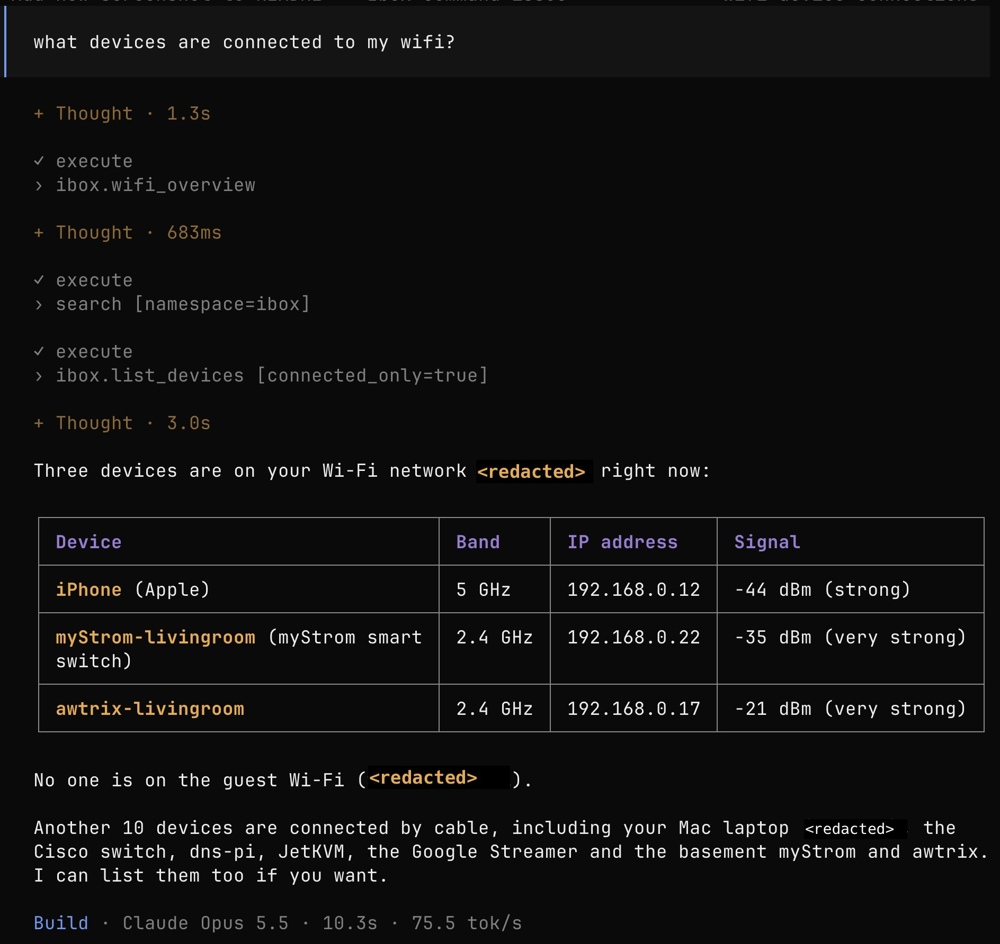

# MCP server

`ibox mcp` is an [MCP](https://modelcontextprotocol.io/) server: it lets an AI app such as [OpenCode](https://opencode.ai/) or Claude Desktop look at your router, e.g. "which devices are on the Wi-Fi?" or "why is my internet slow?", and change settings if you allow it. The app starts the server itself and talks to it over stdio, on your computer.

It needs the optional `mcp` dependencies: `pip install "pyinternetbox[mcp]"`, or no install at all with `uvx --from "pyinternetbox[mcp]" ibox mcp`.



## Setup in OpenCode

Add the server to `opencode.json` in a project, or to `~/.config/opencode/opencode.json` for every project:

```json
{
  "$schema": "https://opencode.ai/config.json",
  "mcp": {
    "servers": {
      "ibox": {
        "type": "local",
        "command": ["uvx", "--from", "pyinternetbox[mcp]", "ibox", "mcp"],
        "environment": {
          "IB_PASSWORD": "{env:IB_PASSWORD}"
        }
      }
    }
  }
}
```

`{env:IB_PASSWORD}` takes the router password from the environment OpenCode runs in. Options for the router, e.g. `-H`, go before `mcp`, and the server's options after it: `["uvx", "--from", "pyinternetbox[mcp]", "ibox", "-H", "192.168.1.1", "mcp", "--allow-writes"]`. `opencode mcp list` checks that the server starts. Other apps that start local MCP servers work the same way: they run `ibox mcp` with `IB_PASSWORD` set.

## What the AI may do

| **Option**           | **Effect**                                                                                                                                                                                                                                          |
| -------------------- | --------------------------------------------------------------------------------------------------------------------------------------------------------------------------------------------------------------------------------------------------- |
| _(none)_             | Read only: overviews of the router, devices, Wi-Fi, internet connection, firewall, DNS, home network, parental controls and remote access, and every other read function of the library through `list_router_functions` and `call_router_function`. |
| `--allow-writes`     | Also changes: rename, block, schedule, wake or forget devices, port forwards, fixed IP addresses, DNS servers for devices, the speed test, and the library's other settings through `change_router_setting`.                                        |
| `--allow-disruptive` | Also changes that cut the Wi-Fi or internet for others: Wi-Fi and guest Wi-Fi on or off, Wi-Fi names, passwords and channels, and restarting the router. Implies `--allow-writes`.                                                                  |
| `--show-secrets`     | Shows passwords and keys, e.g. the Wi-Fi password or a new WireGuard client's private key. Without it they show as `<hidden>`. Confirmation questions always hide them.                                                                             |
| `--metrics-url URL`  | Sends usage metrics to `ibox mcp-exporter` (see below).                                                                                                                                                                                             |

Changes that cut connections ask you first, in the app, like the CLI does: e.g. turning Wi-Fi off, changing Wi-Fi names, passwords or channels, or restarting the router. If you say no, nothing changes. In apps that can't ask (MCP elicitation), these changes are refused: make them with the CLI or the web interface. Other changes don't ask: allow them only if you're happy for the AI to make them, or use your app's permission settings for tools.

The server never offers restoring a backup, factory reset, firmware upgrades, password or LAN address changes, or telephony (calls, DECT, phone book).

`run_speed_test` runs the router's speed test and waits for the ping, download and upload speed: about a minute, during which it uses the whole connection, so everyone's internet is slower. The router doesn't keep the result, so `speed_test_results` shows a test running now and the last result of this server.

Answers are compact JSON, cut off after 25,000 characters so they don't fill the model's context.

## Usage metrics

AI apps start an `ibox mcp` process per window or project, which Prometheus can't scrape. Instead, each one sends an event per tool call to a collector, `ibox mcp-exporter`, which Prometheus scrapes:

```sh
ibox mcp-exporter    # listens on 127.0.0.1:9102; needs no router access
```

Then add `"--metrics-url", "http://127.0.0.1:9102"` after `mcp` in the app's command, or `"IB_MCP_METRICS_URL": "http://127.0.0.1:9102"` to its `environment`. Events carry the tool, the library function it called, its outcome and duration, and the app's name, never the arguments or the answer. When the collector isn't running, events are dropped with one warning, and tool calls never wait for it.

```yaml
scrape_configs:
  - job_name: "ibox-mcp"
    static_configs:
      - targets: ["localhost:9102"]
```

If Prometheus runs in Docker, start the collector with `--host 0.0.0.0`. It then accepts events from anyone who can reach the port.

| **Metric**                            | **Type**  | **Labels**                                                                                                                                                                                                                                                                          |
| ------------------------------------- | --------- | ----------------------------------------------------------------------------------------------------------------------------------------------------------------------------------------------------------------------------------------------------------------------------------- |
| `ibox_mcp_tool_calls_total`           | Counter   | `tool`, e.g. `list_devices`; `function`, the library function it called, e.g. `wifi.summary`; `action`: `read`, `write` or `disruptive`; `outcome`: `ok`, `error`, `refused` (not allowed, or the app can't ask) or `declined` (you said no); `client`, the AI app, e.g. `opencode` |
| `ibox_mcp_tool_call_duration_seconds` | Histogram | `tool`                                                                                                                                                                                                                                                                              |
| `ibox_mcp_events_received_total`      | Counter   |                                                                                                                                                                                                                                                                                     |
| `ibox_mcp_events_rejected_total`      | Counter   | `reason`, e.g. `invalid tool`                                                                                                                                                                                                                                                       |

For example, the tool calls of the last day: `sum by (tool) (increase(ibox_mcp_tool_calls_total[1d]))`.
